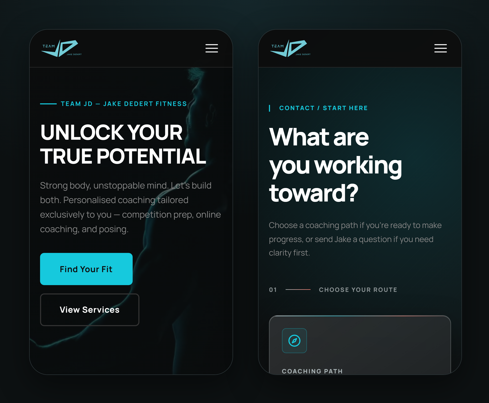

# Team JD

A lead-qualifying website and no-code content dashboard for Team JD, an Adelaide competition preparation coaching business.




> **Status:** deployed to production in November 2026. Public launch is pending, so team-jd.com.au currently shows an under-construction page.

[Case study](docs/case-study.md) · [Live site](https://team-jd.com.au) · [Dashboard guide](site/README.md)

## What it does

Jake Dedert's coaching business was losing leads between its tools: replies went to junk folders, consultation calls could be booked without an application, and new applications sat unseen while he travelled. This project places a website in front of his existing Typeform and Calendly setup that qualifies visitors, delivers every enquiry reliably and lets Jake update the site himself. It began as a WordPress plan and pivoted to a custom React build as AI-assisted development matured; the [case study](docs/case-study.md) explains why.

### Features

- **Find Your Fit:** a short questionnaire that recommends the right service, with Competition Preparation applicants routed through Jake's Typeform application before they can book.
- **Reliable enquiry email:** sent from a verified domain (SPF and DKIM) through Resend, protected by Cloudflare Turnstile and layered rate limits.
- **Jake's dashboard:** photos, videos, results, services, prices, FAQs and settings, with drafts, publishing and a live preview. Sign-in uses a one-time email code.
- **Photo and video framing:** focal-point cropping that adapts to each layout, and loop trimming for the Contact page video.
- **Media pipeline:** phone uploads and Dropbox files are converted to WebP and H.264 and served from Cloudflare R2.
- **Search and AI-crawler output:** server-rendered metadata, structured data and `llms.txt`, generated from the content Jake edits.
- **Operational safeguards:** a staging environment, health-checked deployments and email capacity alerts.

## Tech stack

| Layer | Technologies |
| --- | --- |
| Front end | React 18, React Router, Vite 6, Tailwind CSS, Motion |
| Back end | Node.js 22, Express 4, sharp, ffmpeg |
| Infrastructure | Cloud VM with PM2; Cloudflare DNS, Tunnel, R2 and Turnstile; Resend; Dropbox |
| Testing | 469 automated tests: Node's test runner and supertest (server), Vitest and Testing Library (client) |

## Getting started

**Requirements:** Node.js 22 and npm, and ffmpeg on the `PATH` for video processing.

```bash
cd site
npm install
(cd client && npm install)
cp .env.example .env   # fill in the values you need
npm run dev            # Vite on :5173, Express on :3000
```

Run the test suites from `site/`:

```bash
npm test                  # server
(cd client && npm test)   # client
```

A filled-in `.env` points at production storage. Before editing content locally, follow the local-development notes in the [dashboard guide](site/README.md): dashboard sign-in bypass, asset sync off and a scratch content store.

## Repository structure

| Path | Contents |
| --- | --- |
| [`site/`](site) | The application: Express server, React client, deployment scripts and tests |
| [`site/README.md`](site/README.md) | Architecture, asset pipeline, deployment and Jake's dashboard guide |
| [`docs/`](docs) | Case study, project charter, Gantt chart and setup notes |
| [`requirements/`](requirements) | Requirements interview transcript |

## Author

Built by **Akhilesh Boda**, sole consultant on the project. [LinkedIn](https://www.linkedin.com/in/akhileshboda)

## Licence

© 2026 Akhilesh Boda. All rights reserved. This code is shared for portfolio purposes and is not licensed for reuse. Built for Team JD (Jake Dedert) and shown with permission.
