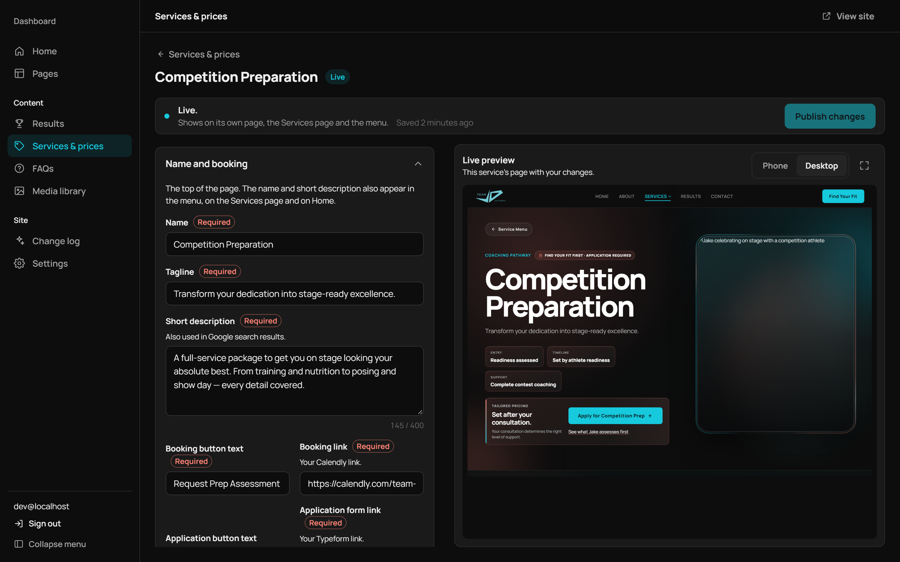

# Team JD

A custom website and content management platform for Jake Dedert, a competition preparation coach, designed to qualify prospective clients and ensure that no enquiry is lost.



**[Read the full case study →](docs/case-study.md)**

| | |
|---|---|
| **Client** | Jake Dedert, Team JD (Adelaide) |
| **Role** | Sole consultant: requirements, design, full-stack development, hosting, documentation |
| **Timeline** | Requirements interview July 2025; build February to October 2026 |
| **Technology** | React and Vite; Node and Express; Cloudflare (Tunnel, R2, Turnstile); Resend; PM2 on Oracle Cloud |
| **Testing** | 435 automated tests (176 server, 259 client) |

## Problem

The requirements interview identified several points at which the client's enquiry process was losing prospective clients:

- For six months, replies to applicants were filtered into junk folders without the client's knowledge.
- The booking link allowed prospective clients to schedule a consultation without completing the application, so the client often joined calls with no background on the caller.
- While the client was overseas, four applications went unseen for four to five days, and two of those applicants engaged other coaches in the meantime.

The client described the previous website as one that "could disappear tomorrow and it would have zero impact on the business."

## Solution

- **Find Your Fit:** a short questionnaire that directs visitors to the most suitable service, together with a gate that routes Competition Preparation applicants through the client's application form before they can book a consultation.
- **Reliable email delivery:** enquiries are sent from a verified domain with SPF and DKIM records, protected by Cloudflare Turnstile and layered rate limits.
- **Client administration dashboard:** management of photographs, results, services, prices, FAQs and site settings, with draft and publish workflows and a live preview. Sign-in uses a six-digit email code, so no password is required.
- **Media pipeline:** phone uploads and Dropbox files are converted to WebP and H.264 and served from Cloudflare R2.
- **Search and AI-crawler support:** metadata and structured data are rendered on the server for the React application, generated from the same content the client edits.
- **Client-facing changelog:** a plain-language record of changes, displayed within the dashboard.

The project was originally scoped as a WordPress site. As AI-assisted development matured, it pivoted to a custom React application. The [case study](docs/case-study.md) sets out the rationale for that pivot, the principal design decisions, the delivery approach, the outcomes and the lessons learned.

## Repository

| Path | Contents |
|---|---|
| [`site/`](site) | The application. [`site/README.md`](site/README.md) documents local setup, architecture, deployment and the client guide. |
| [`docs/`](docs) | The case study, project charter, Gantt chart and setup notes |
| [`requirements/`](requirements) | Requirements interview transcript |

To run the application locally:

```bash
cd site
npm install
cp .env.example .env   # populate the required values
npm run dev
```
