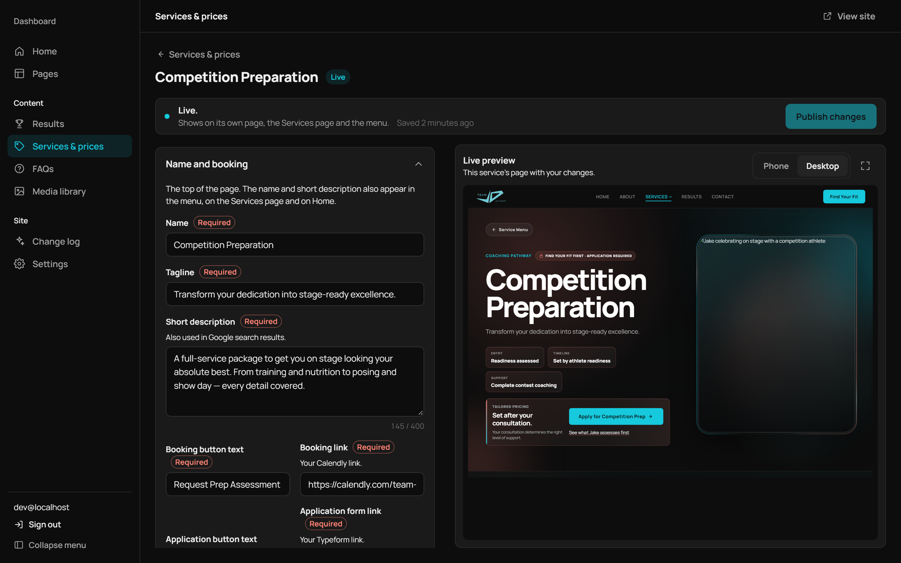
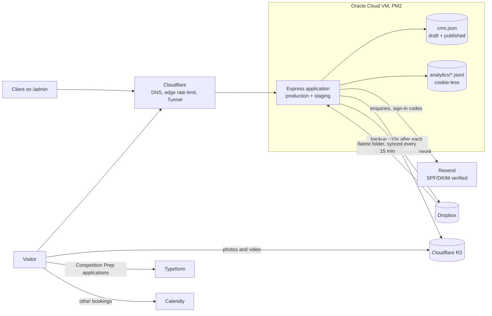
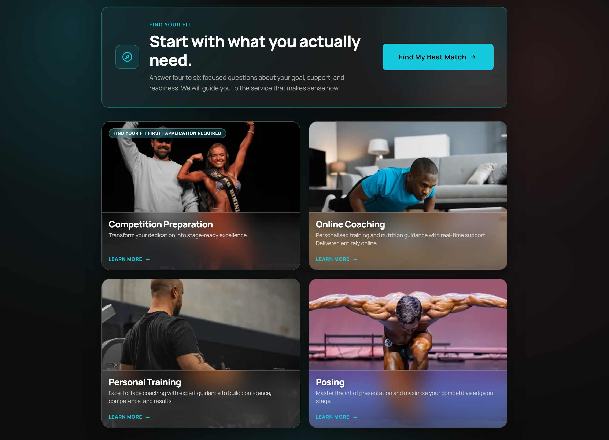
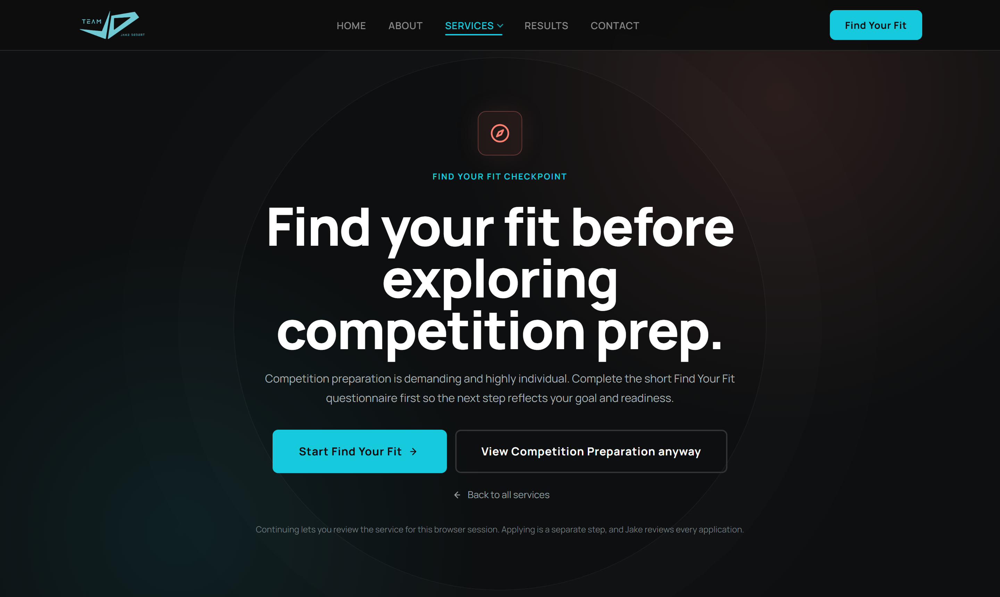
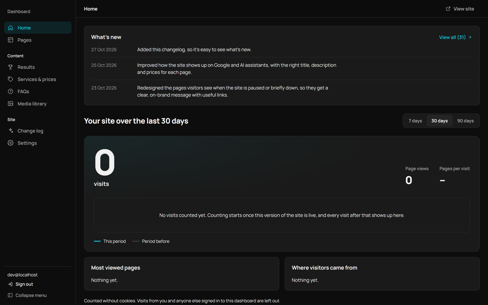
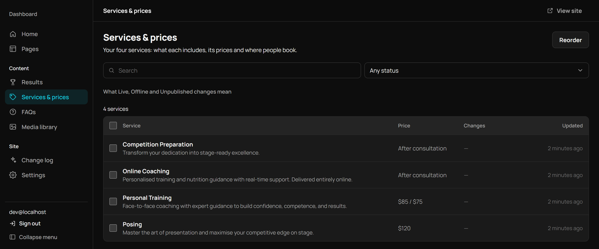

# Team JD: Website and Content Management Platform for a Competition Preparation Coach

*Figure 1. The service editor. Changes appear in the live preview immediately but are not visible to the public until they are published.*

| | |
|---|---|
| **Client** | Jake Dedert, Team JD (competition preparation and body-composition coaching, Adelaide) |
| **Role** | Sole consultant: requirements analysis, design, front-end and back-end development, hosting, documentation |
| **Timeline** | Requirements interview July 2025; build February to October 2026 |
| **Technology** | React 18 and Vite; Node 22 and Express; Cloudflare (Tunnel, R2, Turnstile); Resend; PM2 on an Oracle Cloud virtual machine |
| **Scale** | 106 commits; 435 automated tests; 31 client-facing changelog entries |
| **Website** | [team-jd.com.au](https://team-jd.com.au) |

---

## Executive summary

Team JD was losing prospective clients at several points in its enquiry process. For six months, replies to applicants were filtered into junk folders. Prospective clients could book consultation calls without completing the application form. On one occasion, four applications went unseen for four to five days while the client was overseas, and two of those applicants engaged other coaches in the meantime. The client described the existing website as one that "could disappear tomorrow and it would have zero impact on the business."

This project delivered a custom website that qualifies visitors before they book, sends enquiry email reliably, and gives the client a dashboard for managing photographs, prices, client results and site settings without technical assistance. The project was originally scoped as a WordPress site. As AI-assisted development matured, the project pivoted to a custom React and Express application. This report sets out the rationale for that pivot, the principal design decisions, the outcomes measured against the original success criteria, and the lessons learned.

---

## 1. Client and context

Jake Dedert coaches competitive bodybuilders and clients seeking significant changes in body composition. He holds professional-level certifications across several bodybuilding federations, and most of his clients come to him through referrals and Instagram. Team JD offers four services: Competition Preparation, Online Coaching, Personal Training ($85 per session, or $75 per person for paired sessions) and Posing ($120).

The client wished to grow beyond referrals and identified a specific market he was not reaching:

> "Probably females aged 25–49 who want body composition changes. That less 'Instagrammy' crowd. People who aren't on social media, not into bodybuilding, but still want coaching."

Because this audience is unlikely to discover the business through Instagram, a website that is discoverable through search, explains each service clearly and presents an obvious next step was more important for this group than for the existing following.

## 2. Problem statement

A recorded requirements interview was conducted with the client on 14 July 2025 ([transcript](../requirements/initial-requirements-gathering-transcript.pdf)). It identified four problems, and each major feature of the delivered system addresses at least one of them.

**Undelivered replies.** "I discovered for six months, my reply emails were going to people's junk folders. My lead email had two links, so spam filters caught it." Applicants did not receive the client's follow-up correspondence.

**Unqualified consultation calls.** The client's Typeform application linked to Calendly, but "Typeform lets people book a call without completing the app. I get on a call and I don't know who they are, what they want." Some of these bookings were unsolicited sales approaches from overseas.

**Delayed notifications.** "When I was in Vietnam, I got four applications, didn't see them for 4–5 days, and by then two had signed with other coaches."

**An ineffective website.** The client's Instagram profile linked directly to an application form, and the previous website had been taken offline because it could only be found by "deliberately Googling me and scrolling down 15 results." Prospective clients also tended to assume that he coached only bodybuilders.

The client wished to continue using Typeform and Calendly. The brief was therefore not to replace his existing tools, but to place a website in front of them that would qualify visitors, explain the services and ensure that no enquiry was lost.

## 3. Objectives and success criteria

The project charter ([PDF](Project%20Proposal%20%26%20Charter%20%28Draft%29.pdf)) defined the following success criteria:

- A responsive website deployed to the client's domain
- A 15% increase in enquiries within the first month after launch
- At least five client testimonials and a visible certification badge
- A mobile PageSpeed Insights score of 80 or higher
- WCAG 2.1 AA conformance on the primary pages
- The client able to update a service or testimonial independently following a handover session, supported by a written administration guide
- A published case study (this document)

Section 9 assesses the project against each criterion, including those that cannot yet be evaluated.

## 4. Constraints

The project was delivered by a single consultant working part-time alongside study. It was delivered in-kind, with remuneration to be discussed after handover, so hosting costs needed to remain minimal. The client is not technically trained and frequently travels for competitions, so any system he maintains had to be usable from a phone and could not depend on the consultant's availability. In addition, the site's media library (including 120 client result images, competition footage and testimonials) was held in a Dropbox folder to which the client added material on an ongoing basis.

## 5. The pivot from WordPress to a custom React application

The charter proposed a WordPress site, preceded by Figma wireframes and delivered over three one-week sprints. It explicitly placed "custom plugin development or advanced backend functionality" out of scope. For a solo, part-time engagement in mid-2025 this was the appropriate decision; a bespoke web application would have exceeded what a single developer could responsibly build and maintain.

The subsequent maturing of AI-assisted development changed that assessment. Coding agents capable of implementing a well-specified ticket, writing tests alongside the code and refactoring across an entire codebase made a custom React and Express application a practical option for a single developer. The client and I therefore agreed to pivot to a custom build.

The requirements interview supported this decision. The client's most costly problems occurred *between* his existing tools: an application step that could be bypassed, replies that were filtered as spam, and notifications that were not seen. These were precisely the areas of back-end work that the WordPress plan had excluded. A custom build allowed the project to control the enquiry funnel and the email path directly, and to design an administration dashboard around the four types of content the client actually maintains, rather than providing a general-purpose content management system that would require training.

The pivot also changed the nature of my role. Less of the effort went into writing code by hand, and more into specifying tickets precisely, making product decisions and reviewing the output of the AI agents (see Section 10). The Figma wireframing stage was not carried forward; because iteration in code was now rapid, design work took place directly in the browser.

## 6. System architecture

*Figure 2. System architecture.*

The front end is a React single-page application. To ensure that search engines and AI crawlers receive meaningful content, the Express server renders the document head, structured data (JSON-LD) and a plain-text summary for every route. Media is not served through the virtual machine: images are converted to WebP (maximum width 2,400 px) and videos to H.264 with a poster frame, and both are delivered from Cloudflare R2.

## 7. Key design decisions

| Decision | Alternative considered | Rationale |
|---|---|---|
| Custom React and Express application | WordPress with plugins (the original plan) | AI-assisted development made a custom build practical for a single developer. The client's core problems lay in the enquiry flow and email delivery, which plugins would not have resolved, and a custom build allowed the administration interface to be designed around the client's four content types. |
| Content stored in a single JSON file with draft and published versions, backed up to Dropbox | A relational database (PostgreSQL or SQLite) | The system has one editor and a few hundred records. A single file is straightforward to inspect, back up and restore, and keeps the server configuration simple. |
| Passwordless sign-in using six-digit email codes and an allowlist | Password authentication | Removes the need for the client to manage another password. Codes expire after 10 minutes; five incorrect attempts lock the device concerned, and 25 across all devices invalidate every outstanding code, so a third party cannot lock the client out. |
| Hosting on an Oracle Cloud virtual machine behind a Cloudflare Tunnel | GitHub Pages; subsequently a Raspberry Pi | GitHub Pages cannot run a server. The Raspberry Pi supported staging and production but made availability dependent on a residential connection. The virtual machine is low-cost and continuously available, and with the tunnel the application listens only on the loopback interface. |
| Find Your Fit implemented as a client-side qualification step | Server-enforced gating | The questionnaire is a lead-qualification aid rather than a security control, and is documented as such. The definitive screening step is the client's review of each Typeform application. |
| Server-rendered metadata and an `llms.txt` file for the single-page application | Full server-side rendering or a static-site rewrite | Rendering the head, JSON-LD and a `<noscript>` summary for each route met crawler requirements at much lower cost. Because this output is generated from the same content store, price changes made in the dashboard are reflected in search results. |
| Cookie-less visit statistics | Google Analytics | The client requires only visit counts, popular pages and traffic sources. The chosen approach requires no cookie consent banner, stores no IP addresses or user-agent strings, and excludes bots and signed-in administrators. |

## 8. Solution: mapping problems to features

*Figure 3. The Services page. The Find Your Fit questionnaire (four to six questions) directs visitors to the most suitable service before they book.*

**Unqualified consultation calls: Find Your Fit and the application gate.** Find Your Fit is a short branching questionnaire. For Competition Preparation, the client's most intensive service, visitors are asked to complete it before viewing the service page, and the application button directs them to the client's Typeform application rather than directly to his calendar. As a result, only applicants can reserve time in the client's calendar.

*Figure 4. The Competition Preparation checkpoint. Visitors may proceed without completing the questionnaire; the application itself remains the definitive screening step.*

**Undelivered replies: a correctly configured sending domain.** Enquiries are sent through Resend from a dedicated subdomain with verified SPF and DKIM records. Each enquiry generates a notification to the client and a confirmation to the visitor in a single batch. To prevent abuse of the form, Cloudflare Turnstile verifies that the sender is human, and three layers of rate limiting apply: five attempts per IP address per 15 minutes, three per email address per day (with addresses stored only as HMAC hashes), and 40 enquiries per day across the site.

**Delayed notifications: immediate email delivery to a configurable address.** Enquiries are delivered by email as soon as they are submitted, rather than waiting to be noticed in Typeform. The destination address is a dashboard setting, so the client can direct enquiries to whichever inbox he monitors most closely.

**An ineffective website: discoverable, informative service pages.** Each service has a dedicated page with pricing optimised for mobile devices, and a Results library presents client transformations in a full-screen viewer. Every route has its own title, description and structured data, and the sitemap is generated from the live service data.

**Dependence on the consultant: the administration dashboard.** This requirement did not arise from the interview. It followed from the charter's handover objective, and from the recognition that every content change would otherwise require the consultant's involvement.

*Figure 5. The dashboard home page, shown on a local development copy (visit counts are therefore zero). The "What's new" panel displays the changelog, written for the client rather than for developers.*

The dashboard provides the following functions:

- **Pages.** Every photograph and video position on the site can be replaced. Images store a focal point and zoom level rather than a fixed crop, because the same position has different proportions on mobile and desktop layouts.
- **Results, Services & prices, and FAQs.** Edits are saved automatically as drafts and are published only on request. A Live control adds an item to, or removes it from, the public site.
- **Media library.** Supports uploads from a phone in 32 MB chunks with automatic conversion, and shows where each file is used. Files in use cannot be deleted.
- **Settings.** Controls site visibility (the under-construction page), contact and social media links, the enquiry destination address, search listing text and booking links. Changes take effect as soon as they are saved.
- **Live preview.** Displays the public page alongside the editing form and scrolls to the section being edited.

*Figure 6. The Services & prices list. Services can be edited but not added or removed, because their identifiers are referenced by the contact form, Find Your Fit and the site footer.*

## 9. Outcomes

The website has been built and deployed to the production server. It is currently held behind its under-construction page, which is controlled from the dashboard, so the timing of the public launch rests with the client. Traffic and enquiry data are not yet available, and the assessment below reflects this.

| Charter criterion | Status |
|---|---|
| Responsive website deployed to the domain | **Deployed.** Public launch is controlled by the client. |
| 15% increase in enquiries in the first month | **Not yet measurable.** No pre-launch baseline was recorded, and the site has not yet launched publicly. |
| Five or more testimonials and a certification badge | **Met.** Six client testimonials accompany their results, and federation logos appear on the About page. |
| Mobile PageSpeed score of 80 or higher | **Not yet measured.** |
| WCAG 2.1 AA conformance | **Partially met.** A site audit in September 2026 resolved link-visibility and mobile overflow issues; a formal AA audit has not been conducted. |
| Independent content management, supported by a guide | **Met.** The dashboard and a plain-language guide ([`site/README.md`](../site/README.md)) are complete, and the dashboard was revised following the client's review on 23 October 2026. |
| Published case study | **Met** (this document). |

The codebase includes 435 automated tests: 176 server-side tests (Node's built-in test runner and supertest) and 259 client-side tests (Vitest and Testing Library). They cover sign-in lockouts, rate limiting, the email path, the content store, the deployment scripts and the principal user interface flows. A separate staging environment runs on the same server behind a password-protected gate. Each deployment is uploaded to a fresh directory, promoted, restarted, and must pass a `/healthz` health check before the process manager records its state.

## 10. Delivery approach

Each unit of work began as a Notion ticket containing measurable acceptance criteria and a testing strategy, both written *before* implementation, and concluded with a completion report. This policy is recorded in [`site/AGENTS.md`](../site/AGENTS.md), since AI coding agents carried out much of the implementation. The policy prevented acceptance criteria from being weakened after the fact to match the delivered work, and all agent output was reviewed and tested before acceptance. My responsibilities accordingly centred on specification, product decisions and verification, an arrangement well suited to a project with a single reviewer.

From August 2026, work proceeded on feature branches, and the final two changes were merged through pull requests. The dashboard was delivered in six planned milestones (sign-in and statistics, the content store, media management, services and FAQs, settings, and launch hardening) and was then revised following the client's first review. That revision simplified the interface wording, merged testimonials into results and introduced in-place image cropping.

The changelog originated in the same review. The client had no convenient way to see what had changed between visits, so the dashboard now opens with dated, plain-language entries covering the project from February 2026 onwards.

## 11. Lessons learned

**Record a baseline before development begins.** The charter's primary metric was a 15% increase in enquiries, but the pre-project enquiry volume was never recorded. That criterion therefore cannot be evaluated conclusively, regardless of post-launch performance.

**Revise the charter when the plan changes.** The pivot from WordPress to a custom build was agreed with the client, but the charter was not formally revised. A second version setting out the revised scope and success criteria would have produced a clearer basis for the assessment in Section 9.

**Establish continuous integration from the outset.** The project has no continuous integration pipeline or linter. The test suite is comprehensive but runs only when invoked manually. Running it on Windows during the preparation of this report revealed four deployment-script tests that fail due to Windows path handling, and one dashboard test that fails only when the full suite is run. Continuous integration would have identified both issues when they were introduced.

**Retain a low-fidelity design stage.** Designing directly in code was efficient for development but delayed client feedback, since the client responded only to finished screens. Some of the rework from the first dashboard review could have been identified earlier through wireframes.

**Resolve outstanding items before handover.** The seeded Competition Preparation application link still contains a placeholder identifier that must be configured in Settings before launch, and the visit statistics in `data/analytics/` are not included in the backup routine.

## 12. Timeline

| Date | Milestone |
|---|---|
| 14 July 2025 | Requirements interview; charter and Gantt chart prepared for a WordPress build |
| February 2026 | Rebuild begins as a static site on GitHub Pages |
| April–May 2026 | Migration to Express; Dropbox integration; React and Vite front end |
| June–July 2026 | Redesigned Home, About, Services and Contact pages; branded error pages; Dropbox-to-R2 media pipeline; staging and production on a Raspberry Pi |
| 19–22 July 2026 | Migration to Oracle Cloud |
| July–August 2026 | Results library, Find Your Fit, enquiry email delivery resolved, maintenance mode, pricing |
| August–September 2026 | Application gate for Competition Preparation; site audit remediation |
| 18 October 2026 | Dashboard milestones 1–6 |
| 23 October 2026 | Dashboard revisions following client review; redesigned outage pages |
| 25–27 October 2026 | Search engine and AI-crawler output; changelog |

## Appendix: technology stack and repository structure

**Front end:** React 18, React Router 6, Vite 6, Tailwind CSS 3, Motion. Testing: Vitest, jsdom, Testing Library.
**Back end:** Node 22, Express 4, express-session with a SQLite session store, express-rate-limit, node-cron, sharp, ffmpeg, AWS S3 SDK (for R2), Dropbox SDK. Testing: `node:test`, supertest.
**Infrastructure:** Oracle Cloud virtual machine, PM2 with a systemd unit, Cloudflare DNS, Tunnel, R2 and Turnstile, Resend.

| Path | Contents |
|---|---|
| [`site/`](../site) | The application. Its [README](../site/README.md) documents setup, the asset pipeline and the client guide. |
| [`site/docs/`](../site/docs) | Deployment and media provenance documentation |
| [`docs/`](.) | Project charter, Gantt chart, R2 setup notes and this case study |
| [`requirements/`](../requirements) | Requirements interview transcript |
