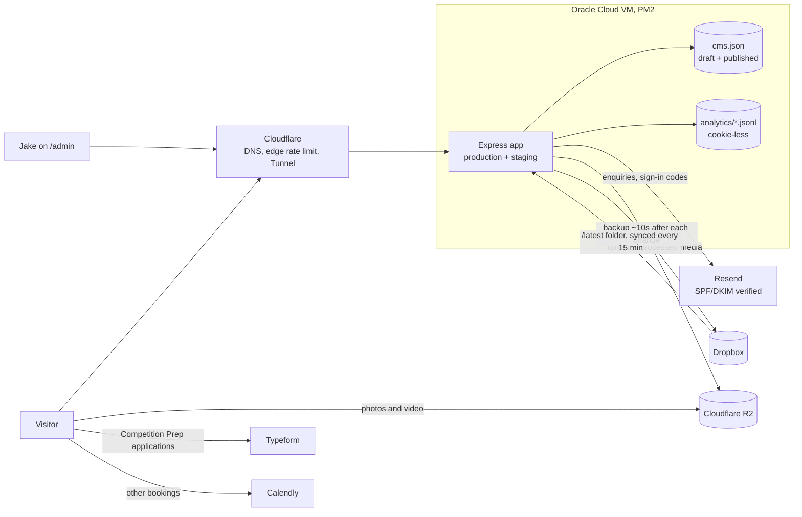

# Team JD: a website and dashboard for a competition-prep coach

*Jake edits a service on the left and sees the real public page update on the right. Nothing reaches visitors until he presses Publish changes.*

| | |
|---|---|
| **Client** | Jake Dedert, Team JD (competition prep and body-composition coach, Adelaide) |
| **My role** | Solo: requirements, design, front end, back end, hosting, documentation |
| **Timeline** | Requirements interview July 2025 · build February to October 2026 |
| **Stack** | React 18 + Vite, Node 22 + Express, Cloudflare (Tunnel, R2, Turnstile), Resend, PM2 on an Oracle Cloud VM |
| **Scale** | 106 commits · 435 automated tests · 31 plain-English changelog entries |
| **Site** | [team-jd.com.au](https://team-jd.com.au) |

---

## TL;DR

Jake's leads were going cold. For six months his replies to applicants landed in junk folders, people booked calls without filling in his application, and while he was travelling two of four new applicants signed with other coaches before he saw their forms. His old website, in his words, "could disappear tomorrow and it would have zero impact on the business."

I built him a custom site that qualifies visitors before they book, sends email that actually arrives, and comes with a dashboard where he can change photos, prices, results and settings himself without touching code. The original plan was a one-month WordPress build. What shipped took about eight months and is a bespoke Express and React app, and most of this write-up explains why that trade was worth making and what I'd change.

---

## 1. Client and context

Jake coaches bodybuilders and people chasing serious body-composition change. He holds pro-level certifications across several federations, and most of his clients find him through referrals or Instagram. He runs four services: Competition Preparation, Online Coaching, Personal Training ($85 solo, $75 per person for pairs) and Posing ($120).

He wanted to grow past referrals. Specifically, he named a market he wasn't reaching:

> "Probably females aged 25–49 who want body composition changes. That less 'Instagrammy' crowd. People who aren't on social media, not into bodybuilding, but still want coaching."

That audience doesn't scroll his Instagram, so a site that ranks, explains the services clearly and makes the next step obvious mattered more for them than for his existing followers.

## 2. The problem

I ran a recorded requirements interview with Jake on 14 July 2025 ([transcript](../requirements/initial-requirements-gathering-transcript.pdf)). Four problems came out of it, and every major feature traces back to one of them.

**Replies vanished.** "I discovered for six months, my reply emails were going to people's junk folders. My lead email had two links, so spam filters caught it." Applicants never saw his follow-ups.

**Calls with strangers.** His Typeform linked to Calendly, and "Typeform lets people book a call without completing the app. I get on a call and I don't know who they are, what they want." Some bookings were overseas sales pitches.

**Slow notifications cost clients.** "When I was in Vietnam, I got four applications, didn't see them for 4–5 days, and by then two had signed with other coaches."

**The website did nothing.** His Instagram bio linked straight to an application form; he'd taken the old site out entirely because nobody found it unless they were "deliberately Googling me and scrolling down 15 results." People also assumed he only coached bodybuilders.

He also wanted to keep Typeform and Calendly, which he already used and mostly liked. So the brief wasn't "replace his tools". It was "put a front door in front of them that filters, explains and doesn't drop anything."

## 3. Goals and how success was defined

My project charter ([PDF](Project%20Proposal%20%26%20Charter%20%28Draft%29.pdf)) set these criteria up front:

- A responsive site live on his domain
- 15% more enquiries in the first month after launch
- At least five testimonials and a visible certification badge
- Mobile PageSpeed score of 80 or more
- WCAG 2.1 AA on the main pages
- Jake able to update a service or testimonial himself after a handover session, backed by a written admin guide
- A case study (this document)

Section 9 scores the project against each one, including the ones I can't claim yet.

## 4. Constraints

I was working alone and part-time, alongside study. The work was in-kind, with pay to be discussed after handover, so hosting had to stay close to free. Jake isn't technical and is often away at competitions or overseas, which meant anything he had to maintain needed to work from his phone and couldn't depend on me being around. And his content (120 client result photos, competition videos, testimonials) lived in a Dropbox folder that he kept adding to.

## 5. Plan versus what happened

The charter planned a WordPress site built in three one-week sprints between 9 July and 8 August 2025, with Figma wireframes first. It listed "custom plugin development or advanced backend functionality" as out of scope.

That isn't what got built. Development started in February 2026 as a static rebuild on GitHub Pages, moved to an Express server in April, gained a React front end in May, and ran through October.

<!-- AUTHOR NOTE (Akhil): the reasoning below is inferred from the requirements and the git history. Rewrite it in your own words if your actual reasons were different, then delete this comment. -->

Looking back at the interview, the gap was there from the start. Jake's most expensive problems were all in the flow between tools: an application that could be skipped, email that didn't arrive, notifications he didn't see. A themed WordPress site with a contact-form plugin would have looked better than his old site without fixing any of that, because the charter had ruled out exactly the backend work those problems needed. Once I accepted that the funnel and the email path were the product, a custom server was the more honest choice, and it let me build an editing experience shaped around the four things Jake changes rather than a general-purpose CMS he'd need training for.

The cost was time. A one-month project became an eight-month one, and the Figma wireframes never happened; I designed directly in code instead. Both appear again under "What I'd do differently".

## 6. Architecture

The React app is a single-page app, but Express renders the head tags, structured data and a text summary for every route so search engines and AI crawlers get real content. Media never goes through the VM on its way to visitors: photos become WebP (up to 2400 px), videos become H.264 with a poster frame, and both are served from R2.

## 7. Key decisions

| Decision | Alternative I rejected | Why |
|---|---|---|
| Custom Express + React app | WordPress with plugins (the original plan) | The core problems were in the lead flow and email path, which plugins would have papered over. A custom build also let me design an admin UI around Jake's four content types. |
| Content in one JSON file with draft and published copies, backed up to Dropbox | A database (Postgres, SQLite) | One editor, a few hundred records. A file is easy to inspect, back up and restore ("copy it back and restart"), and keeps the VM simple. |
| Six-digit email codes for dashboard sign-in, with an allowlist | Passwords | Jake won't remember another password. Codes expire in 10 minutes; five wrong tries lock that device, and 25 across all devices cancel every code, so nobody elsewhere can lock him out. |
| Hosting on an Oracle VM behind a Cloudflare Tunnel | GitHub Pages, then a Raspberry Pi at home | Pages couldn't run a server. The Pi worked for staging and production but tied uptime to a home connection. The Oracle VM is cheap and always on, and with the tunnel the app only listens on localhost. |
| Find Your Fit as a client-side funnel | Server-enforced gating | It's a lead-qualification step, not a security boundary, and I documented it that way. The real filter is Jake reviewing each Typeform application. |
| Server-rendered SEO and an `llms.txt` file for a React SPA | Full server-side rendering or a static-site rewrite | Rendering the head, JSON-LD and a `<noscript>` summary per route was enough for crawlers, and it reads from the same content store, so a price change in the dashboard reaches Google too. |
| Cookie-less visit stats | Google Analytics | Jake only needs visits, top pages and where people came from. No cookie banner, no IP or user agent stored, and bots and admins excluded. |

## 8. From problem to feature

*Find Your Fit sits above the service list: four to six questions that point a visitor to the right service before they book anything.*

**Calls with strangers → Find Your Fit and the Typeform gate.** Find Your Fit is a short branching questionnaire. Competition Prep, Jake's highest-touch service, asks visitors to complete it before they see the service page, and its apply button goes to Jake's Typeform application rather than straight to his calendar. As the changelog puts it for Jake: "only applicants take a spot in his calendar."

*The checkpoint is a nudge, not a wall: "View Competition Preparation anyway" is right there. The application is the real filter.*

**Replies in junk folders → a sending domain set up properly.** Enquiries go out through Resend from a subdomain with SPF and DKIM verified. Each enquiry sends Jake a notification and the visitor a confirmation in one batch. To keep the form from becoming a spam relay, Cloudflare Turnstile checks humans, and there are three layers of limits: 5 attempts per IP per 15 minutes, 3 per email address per day (the address is hashed with HMAC rather than stored), and 40 enquiries a day across the whole site.

**Slow notifications → enquiries in his inbox, and an inbox he can change.** Enquiries arrive as email straight away instead of waiting to be found in Typeform. The destination address is a dashboard setting, so Jake can point it at whatever he checks most without asking me.

**A website that did nothing → pages that explain and rank.** Each service has its own page with pricing that adapts to phones, and a Results library of client transformations opens each story in a full-screen viewer. Every route gets its own title, description and structured data, and the sitemap is built from the live services.

**Me as a bottleneck → the dashboard.** This wasn't in Jake's list of pain points; it came from the charter's handover goal and from realising every photo swap would otherwise be a message to me.

*Dashboard home on a local copy, so the counts are zero. The "What's new" panel is the changelog, written for Jake rather than for developers.*

The dashboard covers:

- **Pages.** Every photo and video spot on the site can be swapped. Photos store a focus point and zoom instead of a fixed crop, because the same spot is a different shape on a phone and on a desktop.
- **Results, Services & prices, FAQs.** Edits autosave as drafts and go live only on Publish. A Live switch takes an item on or off the site.
- **Media library.** Uploads from a phone in 32 MB chunks, converted automatically, with each file showing where it's used. Files in use can't be deleted.
- **Settings.** Site visibility (the under-construction page), contact and social links, where enquiries go, search listings and booking links. These apply as soon as they're saved.
- **Live preview.** The real public page sits in a frame beside the form and scrolls to whichever section is being edited.

*Four services, their prices and their state in one table. Services can be edited but not added or removed, because their IDs are wired into the contact form, Find Your Fit and the footer.*

## 9. Outcome

The site is built and deployed to production on the Oracle VM. It's currently behind its own under-construction page, which is one of the dashboard settings, so Jake controls when it goes public. I don't have traffic or enquiry numbers yet, and I'd rather say so than invent them.

| Charter criterion | Status |
|---|---|
| Responsive site live on the domain | **Deployed**; public launch is Jake's switch to flip |
| +15% enquiries in the first month | **Not measured**: no baseline was recorded, and the site hasn't launched publicly |
| 5+ testimonials, certification badge | **Met**: six client testimonials with their results, and federation logos on About |
| Mobile PageSpeed 80+ | **Not measured** yet |
| WCAG 2.1 AA | **Partly**: a September audit fixed hard-to-spot links and content overflowing on phones, but there's been no formal AA audit |
| Jake can update content himself, with a guide | **Met** for the tooling and the plain-English guide in [`site/README.md`](../site/README.md); the dashboard went through one round of Jake's feedback on 23 October |
| Case study published | This document |

On the engineering side, the repo has 435 automated tests: 176 on the server (Node's test runner and supertest) and 259 on the client (Vitest and Testing Library). They cover sign-in lockouts, rate limits, the email path, the content store, deploy scripts and the main UI flows. A separate staging copy runs on the same VM behind a password screen. Each deploy uploads to a fresh directory, promotes it, restarts the process and has to pass a `/healthz` check before PM2 saves its state.

## 10. How I worked

Every piece of work started as a Notion ticket with acceptance criteria and a testing plan written *before* implementation, and finished with a completion report. That rule lives in [`site/AGENTS.md`](../site/AGENTS.md), because I used AI coding agents for much of the implementation. The file is how I kept them honest: they couldn't quietly weaken a criterion to match what they'd built, and I reviewed and tested what they produced. My job shifted towards writing precise tickets, making the product decisions and checking the work, which suits a solo project where I'm the only reviewer.

From August I worked in feature branches, and the last two changes went through pull requests. The dashboard was built across six planned milestones (sign-in and stats, the content store, media, services and FAQs, settings, launch hardening), then revised after Jake's first review, which simplified the wording, merged testimonials into results and added in-place photo cropping.

The changelog came out of the same review. Jake had no easy way to see what had changed between visits, so the dashboard now opens with dated, plain-English entries going back to February.

## 11. What I'd do differently

**Record a baseline before building.** The charter's headline metric was a 15% rise in enquiries, and I never wrote down how many enquiries Jake got before. I can't prove that number now, whatever happens after launch.

**Renegotiate scope in writing when it changes.** The project moved from WordPress-in-a-month to a custom app over eight months, and the charter never got a v2. The decision was right, but Jake and I should have agreed the new scope and timeline explicitly.

**Set up CI on day one.** There's no CI and no linter. The tests are good, but they only run when I run them, and running them on Windows for this write-up turned up four deploy-script tests that fail on Windows paths and one dashboard test that fails only in the full run. CI would have caught both on the day they appeared.

**Don't skip low-fidelity design.** Designing in code was fast for me but slow for feedback; Jake only reacted to finished screens, so some rework (the first dashboard review) could have happened on paper.

**Close loose ends before calling it done.** The seeded Competition Prep Typeform link is still a placeholder ID that has to be set in Settings before launch, and visit stats in `data/analytics/` aren't backed up.

## 12. Timeline

| When | What happened |
|---|---|
| 14 Jul 2025 | Requirements interview; charter and Gantt chart for a WordPress build |
| Feb 2026 | Rebuild starts as a static site on GitHub Pages |
| Apr–May 2026 | Move to Express, Dropbox integration, React + Vite front end |
| Jun–Jul 2026 | New Home, About, Services and Contact; branded error pages; Dropbox→R2 media pipeline; staging and production on a Raspberry Pi |
| 19–22 Jul 2026 | Migration to Oracle Cloud |
| Jul–Aug 2026 | Results library, Find Your Fit, enquiry email fixed, maintenance mode, pricing |
| Aug–Sep 2026 | Typeform gate for Competition Prep, full site audit fixes |
| 18 Oct 2026 | Dashboard milestones 1–6 |
| 23 Oct 2026 | Dashboard changes from Jake's first review; redesigned outage pages |
| 25–27 Oct 2026 | Search and AI-crawler output; changelog |

## Appendix: stack and repo map

**Front end:** React 18, React Router 6, Vite 6, Tailwind CSS 3, Motion. Tests: Vitest, jsdom, Testing Library.
**Back end:** Node 22, Express 4, express-session with a SQLite session store, express-rate-limit, node-cron, sharp, ffmpeg, AWS S3 SDK (for R2), Dropbox SDK. Tests: `node:test`, supertest.
**Infrastructure:** Oracle Cloud VM, PM2 with a systemd unit, Cloudflare DNS, Tunnel, R2 and Turnstile, Resend.

| Path | Contents |
|---|---|
| [`site/`](../site) | The application; its [README](../site/README.md) covers setup, the asset pipeline and the guide for Jake |
| [`site/docs/`](../site/docs) | Deployment and media provenance |
| [`docs/`](.) | Charter, Gantt chart, R2 setup, this case study |
| [`requirements/`](../requirements) | Interview transcript |
